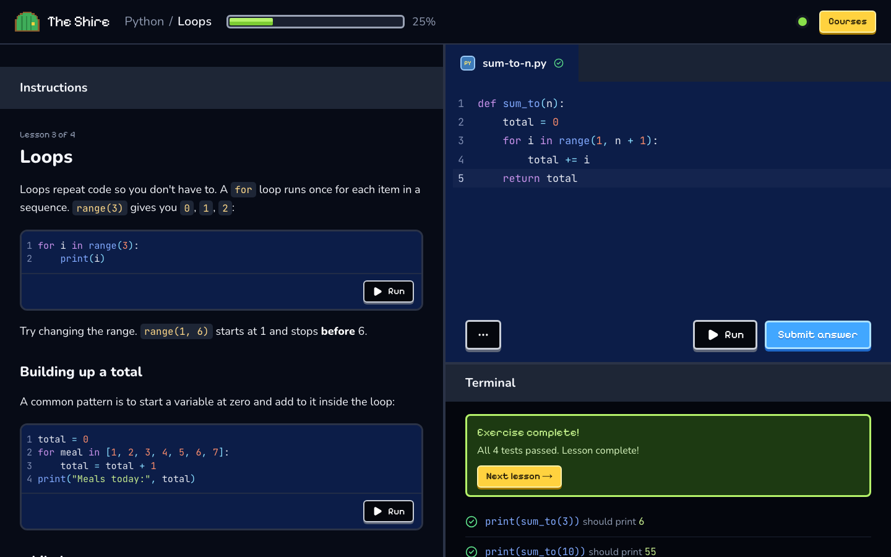
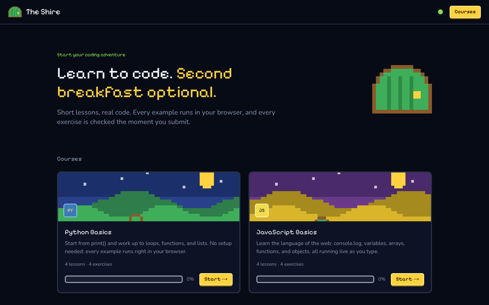
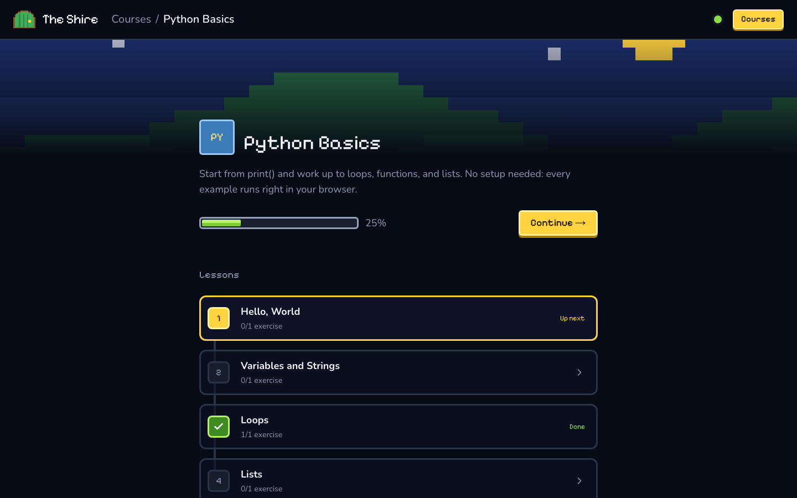
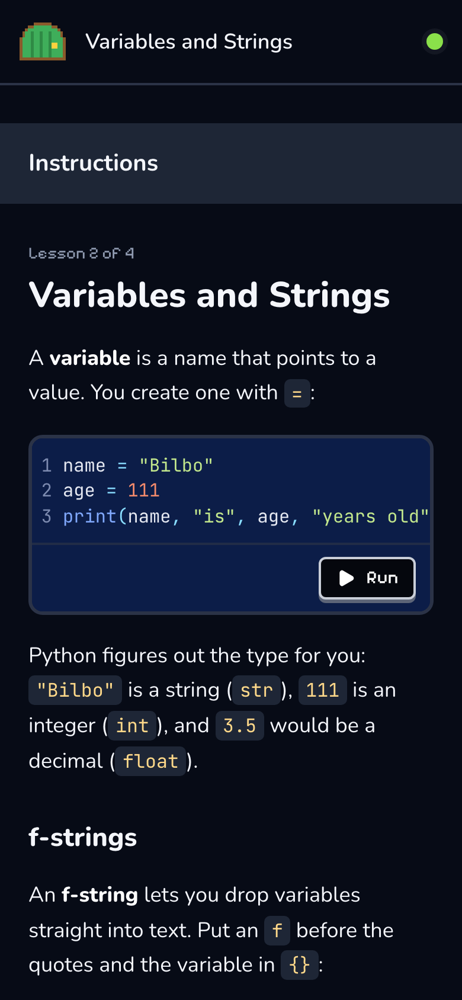
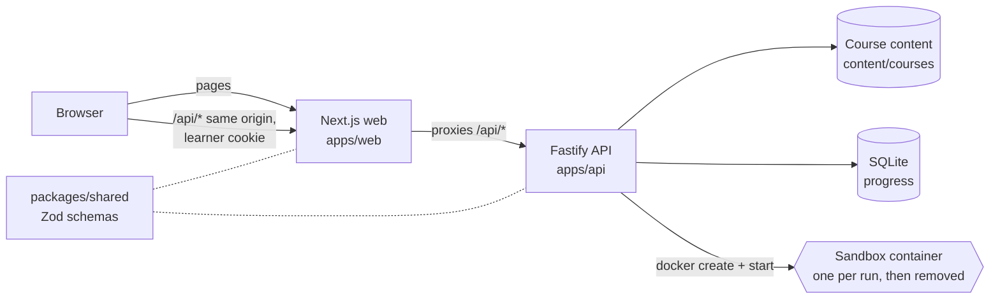

# The Shire

An interactive coding-course platform in the spirit of Codédex: bite-sized Markdown lessons with runnable Python and JavaScript, auto-graded exercises, and per-learner progress. Every line of learner code runs in a fresh, locked-down Docker container.



| Course catalog                      | Course path                       | Mobile                                   |
| ----------------------------------- | --------------------------------- | ---------------------------------------- |
|  |  |  |

**The engineering story:** running untrusted code safely (no network, capped memory/CPU/processes/time/output, read-only filesystem, no capabilities, non-root), behind a typed, UI-agnostic API that any frontend can sit on. The sandbox is tested against fork bombs, infinite loops, memory exhaustion, network and filesystem escapes, and secret leakage. See [docs/security.md](docs/security.md).

## Run it

You need Docker. Then, from a fresh clone:

```sh
docker compose up --build
```

Open http://localhost:3000. The first build takes a few minutes: it builds the API, the web app, and the two sandbox images.

> On macOS, any Docker works. [Colima](https://github.com/abiosoft/colima) is a lightweight option: `brew install colima docker docker-compose && colima start --vm-type vz --cpu 2 --memory 2`.

### Develop with hot reload

Requires Node 24+ (which ships npm 11).

```sh
npm install
npm run runner:build   # build the sandbox images once
npm run dev            # API on :4000, web on :3000
```

| Command                  | What it does                                            |
| ------------------------ | ------------------------------------------------------- |
| `npm run lint`           | ESLint + Prettier check                                 |
| `npm run typecheck`      | `tsc --noEmit` in every workspace                       |
| `npm test`               | Unit and route tests (no Docker needed)                 |
| `npm run test:coverage`  | The same, with a coverage report                        |
| `npm run runner:build`   | Build the Python and Node sandbox images                |
| `npm run test:sandbox`   | Hostile-input and grading tests against real containers |
| `npm run test:e2e`       | Browser smoke test against a running stack              |
| `npm run sandbox:report` | Print the results table used in `docs/security.md`      |
| `npm run docs:api`       | Regenerate `docs/api.md` from the route schemas         |
| `npm run build`          | Build the API bundle and the Next.js app                |

## Architecture



- **`packages/shared`**: Zod schemas for every request and response. The API validates with them, and the web client parses every response with them.
- **`apps/api`**: Fastify. Loads and validates all lessons at startup, runs code through the sandbox, grades exercises, and stores progress in SQLite behind a repository interface.
- **`apps/web`**: Next.js App Router + Tailwind, styled after Codédex's lesson view. The only file that talks to the backend is [`apps/web/lib/api.ts`](apps/web/lib/api.ts).
- **`runner/images`**: minimal Python 3.12 and Node 24 images with no package managers, running as an unprivileged user.
- **`content/courses`**: lessons in Markdown (see [Writing lessons](#writing-lessons)).

### A run, end to end

1. The editor posts `{ language, code }` to `/api/run`, which is rate limited per learner and per IP.
2. A concurrency limiter admits it: 4 at a time, 20 queued, otherwise 429.
3. `docker create` applies every limit, then `docker start --attach` streams the code over stdin. Code never touches a shell string.
4. The host kills the container at 5 s or 64 KB of output; the result reports `timedOut`, `oomKilled`, or `truncated`.
5. The container is force-removed. Labels let a cleanup job remove any orphan a crash leaves behind.

## Design decisions

- **A fresh container per run, created through the Docker CLI.** Simple to reason about, and no state can leak between learners. `create` and `start` are separate so Docker's own messages never mix into learner output, and the CLI runs with a private, empty config so host settings (like `~/.docker/config.json` proxies) can't reach the sandbox.
- **One container per test when grading.** Tests can't interfere with each other, and there's no in-sandbox grader to tamper with. Hidden tests return only a status, never their input or expected output.
- **Content fails at startup, not at request time.** The loader validates every lesson, reports every problem with `file:line`, and the server refuses to start on bad content. CI also runs every reference solution (must pass) and every starter template (must fail) through the real sandbox.
- **Anonymous identity behind one seam.** A signed, HTTP-only cookie sets `request.learnerId`. Route handlers never read cookies, so real auth can replace it.
- **Schemas are the contract.** Shared Zod schemas validate both sides, and [docs/api.md](docs/api.md) is generated from the schemas registered on the routes; a test fails if it drifts.
- **Limits can't be loosened by accident.** Sandbox settings come from validated env vars with hard caps, and unit tests pin every Docker flag.
- **Logs are useful and safe.** Structured JSON with a request id (`X-Request-Id`, echoed in responses); runs log language, size, duration, and outcome, never the code.

## Testing

| Suite             | Command                                        | Covers                                                                                                   |
| ----------------- | ---------------------------------------------- | -------------------------------------------------------------------------------------------------------- |
| Unit + route, 105 | `npm test`                                     | Parser incl. malformed input, loader, grader, identity, rate limits, routes, config, logging, docs drift |
| Sandbox, 26       | `npm run runner:build && npm run test:sandbox` | Hostile inputs against real containers, the full learner flow, every lesson's solution                   |
| End to end, 1     | `npm run test:e2e` (stack running)             | A browser runs code, fails, passes an exercise, and sees progress update                                 |

CI ([.github/workflows/ci.yml](.github/workflows/ci.yml)) runs lint, typecheck, unit tests, and builds; the sandbox suite against real Docker; and the e2e test against `docker compose up`.

Coverage highlights (line coverage): the unit suite covers 99% of the lesson parser and 100% of the content loader, grader, and every route; the sandbox suite covers 88% of the Docker runner, including the hostile-input paths.

## API

| Method | Path                        | Purpose                                          |
| ------ | --------------------------- | ------------------------------------------------ |
| GET    | `/api/health`               | Liveness + Docker availability                   |
| GET    | `/api/courses`              | Course catalog                                   |
| GET    | `/api/courses/:slug`        | Course with ordered lessons                      |
| GET    | `/api/lessons/:id`          | Lesson as structured blocks                      |
| POST   | `/api/run`                  | Run code in the sandbox                          |
| POST   | `/api/exercises/:id/submit` | Grade code against the exercise's tests          |
| GET    | `/api/progress`             | The learner's completed lessons and exercises    |
| PUT    | `/api/progress/:lessonId`   | Mark a lesson complete (its exercises must pass) |

Request and response types and every error code: [docs/api.md](docs/api.md).

## Configuration

All settings are environment variables, validated at startup. Sandbox limits have hard upper bounds, so a typo can't quietly loosen isolation.

| Variable                                       | Default                                    |
| ---------------------------------------------- | ------------------------------------------ |
| `SANDBOX_TIMEOUT_MS`                           | 5000 (max 30000)                           |
| `SANDBOX_MEMORY_MB`                            | 128 (max 512)                              |
| `SANDBOX_CPUS`                                 | 0.5 (max 2)                                |
| `SANDBOX_PIDS_LIMIT`                           | 64 (max 256)                               |
| `SANDBOX_TMPFS_MB`                             | 16 (max 64)                                |
| `SANDBOX_OUTPUT_LIMIT_BYTES`                   | 65536 (max 1 MiB)                          |
| `SANDBOX_MAX_CONCURRENT` / `SANDBOX_MAX_QUEUE` | 4 / 20                                     |
| `SANDBOX_PYTHON_IMAGE` / `SANDBOX_NODE_IMAGE`  | `theshire/runner-{python,node}:latest`     |
| `RATE_LIMIT_PER_LEARNER` / `RATE_LIMIT_PER_IP` | 30 / 120 per minute                        |
| `COOKIE_SECRET`                                | dev-only value; **required** in production |
| `COOKIE_SECURE`                                | `true` in production                       |
| `TRUST_PROXY`                                  | `false` (or a proxy hop count)             |
| `DATABASE_PATH`                                | `data/theshire.db`                         |
| `COURSES_DIR`                                  | nearest `content/courses`                  |
| `LOG_LEVEL`                                    | `info`                                     |

## Writing lessons

Add a folder under `content/courses/` with a `course.json` (`title`, `description`, `language`, `order`) and Markdown lessons:

````md
---
id: python-basics-03
title: Loops
order: 3
---

Plain fenced code is static. Flag a block `runnable` to make it a live cell:

```python runnable
for i in range(3):
    print(i)
```

An `exercise` block is followed directly by its `tests`, and optionally a `hint` and a `solution`:

```python exercise id=sum-to-n
def sum_to(n):
    pass
```

```tests
- call: print(sum_to(3))
  expect: "6"
- call: print(sum_to(100))
  expect: "5050"
  hidden: true
```

```hint
Loop over `range(1, n + 1)` and add each number to a total.
```

```python solution
def sum_to(n):
    return n * (n + 1) // 2
```
````

Each test runs the learner's code followed by `call`, and passes when stdout matches `expect` (ignoring trailing whitespace). Any mistake in a lesson stops the API at startup with the file and line.

## Known limitations

- **Containers share the host kernel.** For stronger isolation, swap in gVisor (`--runtime runsc`) or microVMs. See [docs/security.md](docs/security.md#known-limitations).
- **The API holds the Docker socket**, which is root-equivalent on that host. Deploy it on a dedicated VM.
- **Single instance.** Rate limits and the concurrency limiter live in memory, and SQLite is local. Scaling out needs shared counters and Postgres; the repository interface is ready for it.
- **No accounts.** Progress is tied to a browser cookie; clearing cookies starts over.
- **No stdin.** Programs that call `input()` get end-of-file.
- **Exact output matching.** Exercises must print deterministic text.

## Project plan

Milestones, acceptance criteria, and the UI spec live in [PLAN.md](PLAN.md).
